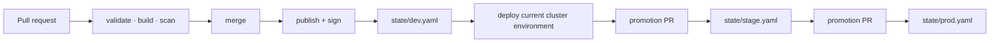
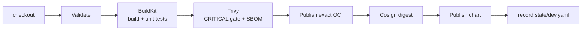
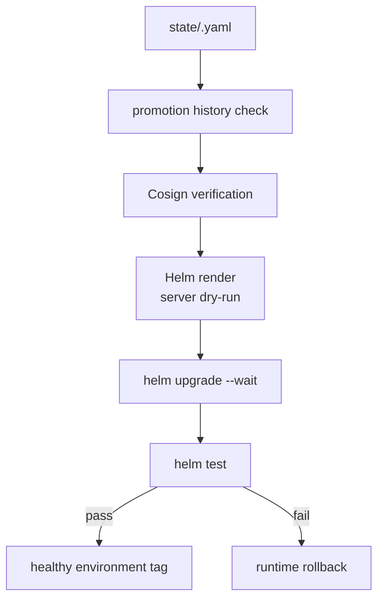
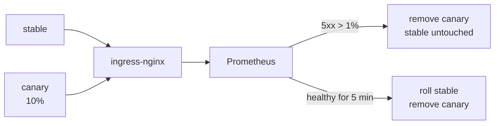
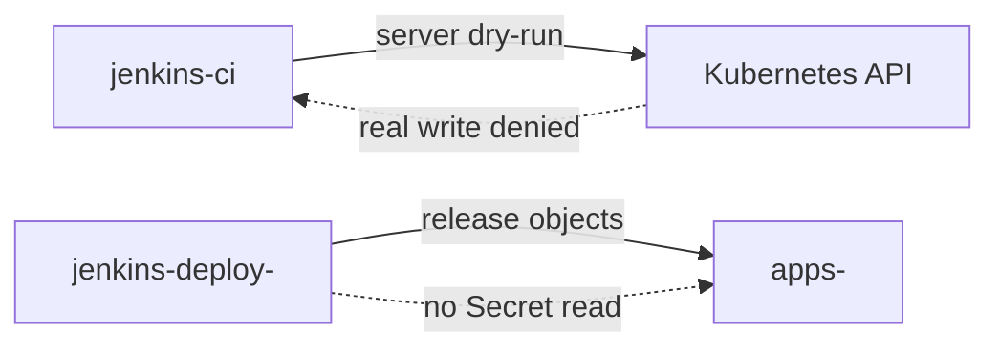

# Delivery

One service contract, one immutable artifact, one Git release record.



> A cluster deploys only the environment named by `clusterEnvironment` in [`environments.yaml`](environments.yaml). The repository currently selects **dev**. Stage/prod state and promotion logic are present for equivalent environment clusters; they are not three namespaces deployed into this one lab cluster.

## Release identity

A release is exactly:

```yaml
sample-java-app:
  version: 1.2.14
  image: sha256:2758e8...
```

- `version` = application version, image tag, and service-chart version.
- `image` = immutable OCI digest that actually runs.
- `state/<environment>.yaml` = desired release identity.

The digest, not the mutable tag, is the runtime identity.

## CI



### Pull requests

For a changed service:

```text
hadolint
version must increase
Helm render + server-side dry-run
build + unit tests
Trivy CRITICAL gate
SBOM archive
```

The webhook service is linted instead of server-dry-run before it has been installed, because its deployment is operator-owned rather than released by the application deploy job.

### Main

CI does **not** rebuild after scanning.

```text
app-image/ OCI layout
      │
      ├── Trivy scans these bytes
      └── skopeo publishes these bytes
                 │
                 ▼
          registry digest
                 │ exact digest check
                 ▼
              Cosign
```

A published version may be reused only when its OCI source-revision label matches the service source revision. Reusing a version for different source fails.

**Code:** [service pipeline](delivery/pipeline/vars/servicePipeline.groovy) · [build](delivery/pipeline/resources/lab/delivery/build-image.sh) · [scan](delivery/pipeline/resources/lab/delivery/scan-image.sh) · [publish](delivery/pipeline/resources/lab/delivery/publish-image.sh)

## CD



Before deployment, the job verifies:

1. a release entering stage/prod previously existed in the preceding environment's Git history;
2. the recorded image digest carries the delivery signature;
3. the rendered release passes the Kubernetes API server and admission chain.

Then the environment-specific CD identity performs `helm upgrade --install --wait --rollback-on-failure` and `helm test`.

A failed Helm test explicitly rolls the release to its previous revision.

## Promotion

```text
dev healthy
   │
   └──► PR: state/stage.yaml
                 │ review + merge
                 ▼
            stage desired state
                 │
                 └──► PR: state/prod.yaml
                               │ code-owner review + merge
                               ▼
                          prod desired state
```

Promotion PRs copy the **same `{version,image}` pair** forward. Nothing is rebuilt between environments.

Environment tags use:

```text
dev-2026.09.21.1
stage-2026.09.21.1
prod-2026.09.21.1
```

A tag identifies the complete state of a healthy environment.

## Production canary

When the target environment has a `canary` policy:



The current prod policy is 10% traffic for five minutes with a 1% 5xx threshold.

**Code:** [environments.yaml](environments.yaml) · [deploy.sh](delivery/pipeline/resources/lab/delivery/deploy.sh)

## Zero-downtime mechanics

The application chart combines:

```text
maxUnavailable: 0
readiness probe
startup + liveness probes
graceful Spring shutdown
30s pod termination grace
Helm --wait
post-deploy smoke test
```

Prod uses four replicas and `maxSurge: 4`. Dev/stage use one replica and `maxSurge: 1`.

## Identities



| Identity | Runtime authority |
|---|---|
| `jenkins-ci` | server-side dry-run only |
| `jenkins-deploy-<environment>` | release objects in its one environment namespace |
| Jenkins controller | no build executor; schedules agent Pods |

No deployment kubeconfig is stored in Jenkins.

## Jobs

JCasC creates four delivery multibranch jobs:

| Job | Entry | Role |
|---|---|---|
| `sample-java-app` | `app/Jenkinsfile` | service CI |
| `resource-requests-webhook` | policy Jenkinsfile | policy image CI |
| `platform` | `delivery/Jenkinsfile.platform` | repository checks + base-chart publish |
| `deploy` | `delivery/Jenkinsfile.deploy` | state verification + current-environment CD |

Warm-runner jobs exist only to keep one reusable agent of each execution class ready.

## Change map

| Change | Source |
|---|---|
| service CI | [`servicePipeline.groovy`](delivery/pipeline/vars/servicePipeline.groovy) |
| environment CD | [`deployPipeline.groovy`](delivery/pipeline/vars/deployPipeline.groovy) |
| shared delivery helpers | [`delivery.groovy`](delivery/pipeline/vars/delivery.groovy) |
| image build / scan / publish | [`delivery/pipeline/resources/`](delivery/pipeline/resources/lab/delivery/) |
| Jenkins jobs / agents | [JCasC](platform/jenkins/jcasc/jenkins.yaml) |
| service runtime | [base chart](charts/service/README.md) |
| desired releases | [`state/`](state/) |

Requirements mapping and deliberate requirement differences live in **[docs/REQUIREMENTS.md](docs/REQUIREMENTS.md)**.
