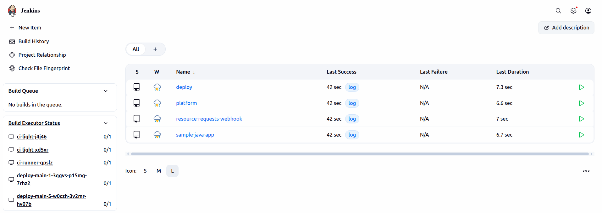
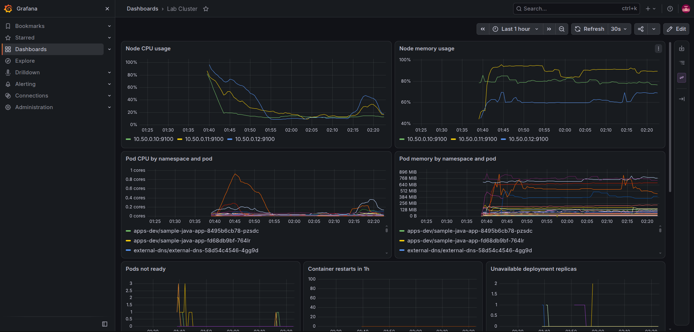
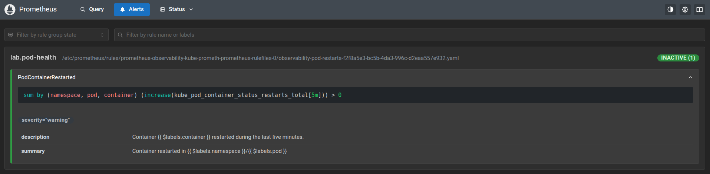

# Kubernetes Platform Lab

A production-style Kubernetes lab where the host, VMs, edge, delivery,
observability, and policy layers are all managed from this repository.

## Repository map

Each folder has its own detailed guide.

- [infra/](infra/README.md) — VMs, kubeadm, Ansible, host DNS, Vault.
- [platform/](platform/README.md) — edge, Jenkins, environment, observability.
- [delivery/](delivery/README.md) — Jenkins pipelines and release scripts.
- [state/](state/) — desired version + image digest per environment.
- [app/](app/README.md) — Java app, image, runtime values.
- [charts/service/](charts/service/README.md) — reusable service chart.
- [policies/](policies/README.md) — admission controls.
- [validation/](validation/README.md) — platform and end-to-end proof.
- [DELIVERY.md](DELIVERY.md) — release and promotion model.
- [RUNBOOK.md](RUNBOOK.md) — commands, credentials, recovery, teardown.

## Contents

1. [Physical architecture](#1-physical-architecture)
2. [External request path](#2-external-request-path)
3. [Application request + log path](#3-application-request--log-path)
4. [Immutable release path](#4-immutable-release-path)
5. [Secrets and trust path](#5-secrets-and-trust-path)
6. [Observability path](#6-observability-path)
7. [Operator path](#7-operator-path)
8. [Design decisions](#8-design-decisions)

[Host requirements](#host-requirements)

## 1. Physical architecture

~~~text
                    ┌──────────────────────────────┐
                    │        OPERATOR HOST         │
                    │ Ubuntu x86_64                │
                    │ BIND9 · Vault · local CA     │
                    │ Vagrant · Ansible            │
                    └──────────────┬───────────────┘
                                   │ create + reconcile
                                   ▼
                 ┌─────────────────────────────────┐
                 │      VirtualBox VM cluster      │
                 │         10.50.0.0/24            │
                 └───────────────┬─────────────────┘
                                 │
                                 ▼
                       ┌───────────────────┐
                       │ node-1            │
                       │ CONTROL PLANE     │
                       │ 10.50.0.10        │
                       │ 2 CPU · 2 GiB     │
                       │ API · etcd        │
                       │ scheduler         │
                       └─────────┬─────────┘
                                 │
                    ┌────────────┴────────────┐
                    │                         │
                    ▼                         ▼
          ┌────────────────────┐    ┌────────────────────┐
          │ node-2             │    │ node-3             │
          │ WORKER             │    │ WORKER             │
          │ 10.50.0.11         │    │ 10.50.0.12         │
          │ edge .11           │    │ edge .12           │
          │ 2 CPU · 4 GiB      │    │ 2 CPU · 4 GiB      │
          │ app · Prom · ES    │    │ app · Jenkins      │
          └─────────┬──────────┘    └─────────┬──────────┘
                    │                         │
                    └────────────┬────────────┘
                                 ▼
                      192.168.56.0/24 edge
                                 │
                                 ▼
                     MetalLB 192.168.56.200
~~~

The control plane stays on the private cluster network. Only the workers
join the host-accessible edge network.

~~~text
cluster network   10.50.0.0/24
Pod CIDR          10.60.0.0/16
Service CIDR      10.70.0.0/16
edge network      192.168.56.0/24
MetalLB pool      192.168.56.200 - 192.168.56.220
~~~

**Source:** [Vagrantfile](Vagrantfile) ·
[cluster automation](infra/ansible/README.md)

## 2. External request path

~~~text
                      DNS CONTROL PATH

                 ┌──────────────────┐
                 │ Service/Ingress  │
                 └────────┬─────────┘
                          │ watched by
                          ▼
                 ┌──────────────────┐
                 │ ExternalDNS      │
                 │ RFC2136 + TSIG   │
                 └────────┬─────────┘
                          │ signed update
                          ▼
                 ┌──────────────────┐
                 │ BIND9 on host    │
                 │ lab.test         │
                 └──────────────────┘

                     USER TRAFFIC PATH

client
  │ DNS lookup
  ▼
┌──────────────────┐
│ BIND9            │
│ authoritative    │
└────────┬─────────┘
         │ returns 192.168.56.200
         ▼
┌──────────────────┐
│ MetalLB VIP      │
│ 192.168.56.200   │
└────────┬─────────┘
         ▼
┌──────────────────┐
│ ingress-nginx    │
│ TLS + host route │
└────────┬─────────┘
         ▼
┌──────────────────┐
│ Service          │
│ ClusterIP        │
└────────┬─────────┘
         ▼
┌──────────────────┐
│ Java Pod         │
│ /api/foos        │
└──────────────────┘
~~~

The DNS control path and the user traffic path are separate on purpose:
ExternalDNS changes records; client traffic never passes through ExternalDNS.

**Source:** [edge orchestration](infra/edge/README.md) ·
[platform edge](platform/edge/README.md)

## 3. Application request + log path

~~~text
GET /api/foos?val=hello
          │
          ▼
┌──────────────────────┐
│ Spring Boot app      │
│ returns query value  │
└──────────┬───────────┘
           │
           ├──────────────► HTTP response
           │
           ▼
┌──────────────────────┐
│ async rolling file   │
│ /var/log/app/app.log │
└──────────┬───────────┘
           ▼
┌──────────────────────┐
│ Fluent Bit sidecar   │
└──────────┬───────────┘
           ▼
┌──────────────────────┐
│ Elasticsearch        │
│ app-logs             │
└──────────────────────┘
~~~

The explicit application file log is separate from normal container logs,
which are collected cluster-wide.

**Source:** [application](app/README.md) ·
[observability](platform/observability/README.md)

## 4. Immutable release path

~~~text
GitHub PR
   │
   ▼
┌────────────────────────┐
│ Jenkins validation     │
│ lint · chart · dry-run │
└───────────┬────────────┘
            ▼
┌────────────────────────┐
│ BuildKit               │
│ build once + unit test │
└───────────┬────────────┘
            ▼
┌────────────────────────┐
│ Trivy                  │
│ CRITICAL gate + SBOM   │
└───────────┬────────────┘
            │ merge to main
            ▼
┌────────────────────────┐
│ publish SAME OCI bytes │
│ verify registry digest │
└───────────┬────────────┘
            ▼
┌────────────────────────┐
│ Cosign exact digest    │
└───────────┬────────────┘
            ▼
┌────────────────────────┐
│ state/dev.yaml         │
│ version + image digest │
└───────────┬────────────┘
            ▼
┌────────────────────────┐
│ deploy verification    │
│ signature · promotion  │
│ render · server dryrun │
└───────────┬────────────┘
            ▼
┌────────────────────────┐
│ Helm upgrade --wait    │
│ exact image digest     │
└───────────┬────────────┘
            ▼
┌────────────────────────┐
│ Helm test / smoke      │
└───────────┬────────────┘
            │ healthy
            ▼
┌────────────────────────┐
│ environment tag        │
│ dev-YYYY.MM.DD.N       │
└───────────┬────────────┘
            ▼
┌────────────────────────┐
│ promotion PR           │
│ dev → stage → prod     │
│ same version + digest  │
└────────────────────────┘
~~~

This lab cluster runs the environment selected by
[environments.yaml](environments.yaml), currently **dev**. Stage and prod
state model promotion to equivalent environment clusters.

**Source:** [DELIVERY.md](DELIVERY.md) · [delivery/](delivery/README.md)

## 5. Secrets and trust path

~~~text
                         ┌─────────────────┐
                         │ Vault on host   │
                         │ Raft + TLS      │
                         └────────┬────────┘
                                  │
                     ┌────────────┴────────────┐
                     │                         │
                     ▼                         ▼
           ┌──────────────────┐      ┌──────────────────┐
           │ Vault Agent      │      │ Vault Secrets    │
           │ host-side render │      │ Operator         │
           └────────┬─────────┘      └────────┬─────────┘
                    │                         │
                    ▼                         ▼
           ┌──────────────────┐      ┌──────────────────┐
           │ BIND9 TSIG key   │      │ K8s Secrets     │
           └──────────────────┘      └────────┬─────────┘
                                             │
                               ┌─────────────┼─────────────┐
                               ▼             ▼             ▼
                         ExternalDNS      Jenkins      registry
~~~

Secrets are delivered at runtime rather than committed to Git. Jenkins
deployments use Kubernetes service accounts instead of a stored kubeconfig.

**Source:** [edge trust](infra/edge/README.md) ·
[Jenkins](platform/jenkins/README.md)

## 6. Observability path

~~~text
                         METRICS

app / nodes / ingress
         │
         ▼
┌──────────────────┐
│ Prometheus       │
└────────┬─────────┘
         │
    ┌────┴──────────────┐
    │                   │
    ▼                   ▼
┌──────────────┐   ┌──────────────┐
│ Grafana      │   │ Alert rules  │
│ dashboards   │   │ pod restart  │
└──────────────┘   └──────┬───────┘
                           ▼
                    ┌──────────────┐
                    │ Alertmanager │
                    └──────────────┘

                           LOGS

/var/log/containers/*.log
          │
          ▼
┌─────────────────────┐
│ Fluent Bit DaemonSet│
└──────────┬──────────┘
           │
           ├───────────────────────┐
           │                       │
app.log    │                       ▼
   │       │               ┌──────────────────┐
   ▼       │               │ Elasticsearch    │
┌──────────────┐           │ kubernetes-*     │
│ sidecar FB   │──────────►│ app-logs         │
└──────────────┘           └────────┬─────────┘
                                   ▼
                            ┌──────────────┐
                            │ Grafana      │
                            │ log panels   │
                            └──────────────┘
~~~

Prometheus and Elasticsearch use local-path persistence. Grafana,
Prometheus and Elasticsearch share the `observability` hostname;
Elasticsearch has no authentication, so it is lab-only.

**Source:** [observability](platform/observability/README.md)

## 7. Operator path

~~~text
make prerequisites
      │
      ▼
make cluster-up
      │
      ▼
make cluster-validate
      │
      ▼
make edge-up ─────────────► make edge-smoke
      │
      ▼
make jenkins-up
      │
      ▼
make environment-up
      │
      ▼
make observability-up ────► make observability-smoke
      │
      ▼
make policies-up
      │
      ▼
make e2e-validate
~~~

Use **[RUNBOOK.md](RUNBOOK.md)** for credentials, exact commands,
validation, recovery, rollback, stop, and teardown.

## 8. Design decisions

- **Helm releases apps; Ansible builds the cluster.** Helm already waits
  for readiness, runs tests, keeps history and rolls back. Wrapping it in
  Ansible would add a layer and nothing else.
- **One LoadBalancer.** Every hostname, Jenkins included, shares one
  MetalLB address and one wildcard certificate behind ingress-nginx.
- **Dev runs 1 pod.** Prod is 4 pods spread over both workers. Set
  `replicas: 4` in [values-dev.yaml](app/chart/values-dev.yaml) to run the
  prod shape on the lab.

### Logging

~~~text
logger ──► async queue ──► app.log ──► fluent-bit sidecar ──► Elasticsearch
  │                          │
  │                          └── new file every day · 100 MB per file · 1 GB archive cap
  │
  └──► stdout: WARN and ERROR only
~~~

Request threads never wait on disk. Only warnings and errors reach stdout:
enough for `kubectl logs`, without the cost of every request line.
Source: [logback-spring.xml](app/src/main/resources/logback-spring.xml).

### Zero downtime

A rollout never removes capacity (`maxUnavailable: 0`). A new pod gets
traffic only after its readiness probe passes, and old pods drain
gracefully for 30 s. The deploy waits for the rollout, runs a smoke test
and rolls back on failure. A PodDisruptionBudget keeps two pods up during
node maintenance.

### Priority under load

[priority-preemption.yaml](docs/examples/priority-preemption.yaml):
a latency-critical service scales on CPU with a high PriorityClass; a batch
worker runs at low priority. When nodes are full, the scheduler evicts
batch pods to make room, and they return when the load drops.

### Production canary

~~~text
                   app.lab.test
                         │
                   ingress-nginx
              ┌──────────┴──────────┐
             90 %                  10 %
              ▼                     ▼
     stable · 4 pods         canary · 1 pod · new version
                                    │
                      5xx rate from Prometheus
                      checked every minute for 5 minutes
                                    │
                    ┌───────────────┴───────────────┐
                 ≤ 1 %                            > 1 %
                    ▼                               ▼
     roll stable to the new version          delete canary
     then delete canary                      stable untouched
~~~

A metric makes the call, not a person. Settings live in
[environments.yaml](environments.yaml); the logic is in
[deploy.sh](delivery/pipeline/resources/lab/delivery/deploy.sh).

## Host requirements

The operator host is **Ubuntu x86_64** with CPU virtualization enabled.
If the host is itself a VM, it needs nested virtualization.
Plan for 10 GiB of free RAM, because the three cluster VMs use that much.

Install everything with one command:

~~~bash
make prerequisites
~~~

Continue with `make cluster-up` in the same shell. No new login is needed.

~~~text
make prerequisites
      │
      ├── apt ─────────► VirtualBox · Vagrant (HashiCorp repo)
      │                  Ansible + posix/general collections
      │                  kubectl 1.34 (pkgs.k8s.io) · Helm (helm repo)
      │                  Docker · dig/nsupdate · jq · python3-yaml
      │                  git · make · ssh · iproute2
      │
      └── VirtualBox ──► default vboxnet0 DHCP off
                         (it overlaps the MetalLB pool)
~~~

Vault and BIND9 are not listed. `make edge-up` installs them with Ansible.

The kubectl minor version follows the cluster version in
`infra/ansible/group_vars/all.yml`. The script is
[infra/bin/prerequisites](infra/bin/prerequisites).
