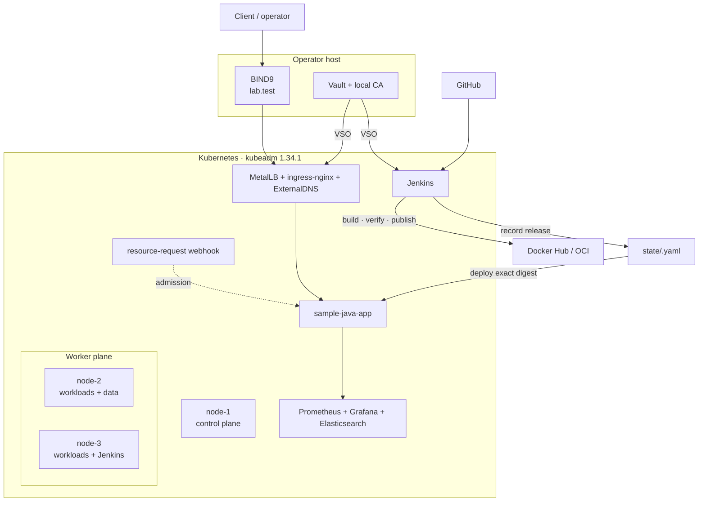
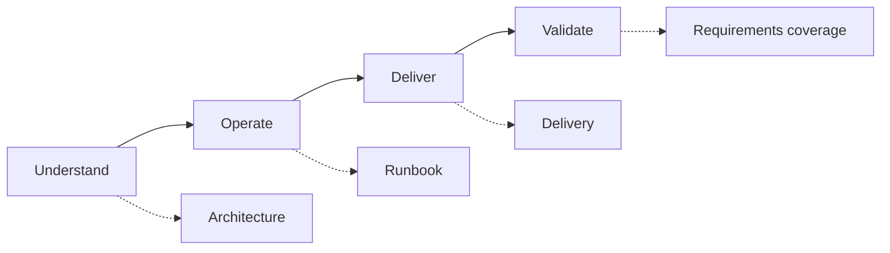

# Lab Kubernetes Platform

A three-node Kubernetes platform built for the Lab DevOps case: cluster bootstrap, edge networking, secrets, CI/CD, observability, admission control, and immutable application delivery live in one repository.



## Requirements at a glance

| Case area | Implementation | Read |
|---|---|---|
| **Step 1** · app, image, cluster, DNS, Jenkins, observability, logging | kubeadm + Ansible, pinned multi-stage images, ExternalDNS, JCasC, Vault, Prometheus/Grafana/Elasticsearch, async file logging | [Requirements coverage](docs/REQUIREMENTS.md#step-1--platform-foundation) |
| **Step 2** · runtime, pipelines, zero downtime, webhook | shared Helm service chart, Jenkins shared library, immutable image digests, rolling updates, custom validating webhook | [Requirements coverage](docs/REQUIREMENTS.md#step-2--application-delivery) |
| **Step 3** · constrained scaling + risky releases | priority/preemption design for App X/Y; ingress-nginx canary with Prometheus guard for critical releases | [Requirements coverage](docs/REQUIREMENTS.md#step-3--design-scenarios) |

The requirements ask for brief implementation and design documentation. The requirement-by-requirement answer — including the few places where the repository deliberately differs from the literal wording — is in **[docs/REQUIREMENTS.md](docs/REQUIREMENTS.md)**.

## Start here



| I want to… | Go to |
|---|---|
| understand the whole system | **[Architecture](docs/ARCHITECTURE.md)** |
| boot / reconcile / validate it | **[Runbook](RUNBOOK.md)** |
| understand CI/CD and promotion | **[Delivery](DELIVERY.md)** |
| check every requirement | **[Requirements coverage](docs/REQUIREMENTS.md)** |

## Bootstrap path

Run from the repository root on Ubuntu x86_64.

```bash
make cluster-up
make cluster-validate

make edge-up
make edge-smoke

make jenkins-up
make environment-up

make observability-up
make observability-smoke

make policies-up
make e2e-validate
```

Credentials and first-run ordering are intentionally kept out of this landing page. Use the **[runbook](RUNBOOK.md)** for the exact sequence.

## Physical topology

```text
10.50.0.0/24 · private Kubernetes network

node-1                    node-2                    node-3
control plane             worker                    worker
10.50.0.10                10.50.0.11                10.50.0.12
                              │                         │
                        192.168.56.11             192.168.56.12
                              └──────────┬──────────────┘
                                         │
                           192.168.56.0/24 · edge
                                         │
                              ingress VIP .200
```

| Network | CIDR |
|---|---|
| VM | `10.50.0.0/24` |
| Pod | `10.60.0.0/16` |
| Service | `10.70.0.0/16` |
| host edge | `192.168.56.0/24` |

## Repository map

| Area | Owns |
|---|---|
| [`infra/`](infra/README.md) | VMs, kubeadm foundation, host DNS, Vault, CA |
| [`platform/`](platform/README.md) | ingress, Jenkins, environment identity, observability |
| [`delivery/`](delivery/README.md) | Jenkins shared library and release mechanics |
| [`app/`](app/README.md) | Java service, image, chart values, file logging |
| [`charts/service/`](charts/service/README.md) | reusable stateless-service runtime contract |
| [`policies/`](policies/README.md) | admission enforcement |
| [`state/`](state/) | desired release identity per environment |
| [`validation/`](validation/README.md) | executable proofs of system behavior |

### Component deep dives

[Jenkins](platform/jenkins/README.md) ·
[Edge](infra/edge/README.md) ·
[Observability](platform/observability/README.md) ·
[Resource policy](policies/resource-requests-webhook/README.md) ·
[CI agent](delivery/jenkins/README.md)

## Core design rules

```text
build once                 promote the same digest
Git records desired state  runtime changes are validated
secrets stay out of Git    identities get only the access they need
validation proves outcomes configuration owns reconciliation
```

That is the repository contract. The implementation files linked above are the source of truth; documentation explains the system rather than duplicating it.
