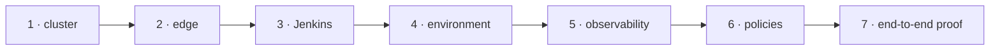
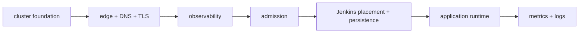

# Runbook

The normal operator path is linear. Use this page for commands; use the linked component pages only when a phase fails.



## Before first boot

Host assumptions:

```text
Ubuntu x86_64
Vagrant + VirtualBox
Ansible
Docker
kubectl + Helm
Vault CLI
make
```

The lab needs the configured `10.50.0.0/24` private network and `192.168.56.0/24` host edge to be free of conflicting routes / VirtualBox DHCP networks. `Vagrantfile` checks this before VM creation.

## 1 · Cluster

```bash
make cluster-up
make cluster-validate
```

Expected shape:

```text
node-1  control plane  10.50.0.10
node-2  worker         10.50.0.11
node-3  worker         10.50.0.12
Kubernetes             v1.34.1
Pod CIDR               10.60.0.0/16
Service CIDR           10.70.0.0/16
```

Permanent node fixes belong in [`infra/ansible/`](infra/ansible/README.md), then reprovision with `vagrant provision node-3`.

## 2 · Edge + trust

```bash
make edge-up
make edge-smoke
```

First run creates the local CA, Vault state, BIND9, Vault identities, Vault Secrets Operator, MetalLB, ingress-nginx, ExternalDNS, and the retained edge health endpoint.

Vault root/unseal material is written outside Git to the configured operator-state file.

Deep check:

```bash
make edge-validate
```

Edge ownership: [infra/edge](infra/edge/README.md)

## 3 · Jenkins credentials

Jenkins can reuse credentials already stored in Vault. On a fresh Vault, inject the external values once:

```bash
export GITHUB_USERNAME='<github-user>'
export GITHUB_TOKEN='<github-token>'

export DOCKERHUB_USERNAME='<dockerhub-user>'
export DOCKERHUB_TOKEN='<dockerhub-token>'

export COSIGN_PASSWORD='<signing-key-password>'
export COSIGN_PRIVATE_KEY="$(cat cosign.key)"

make jenkins-up
```

`make jenkins-up` stores/reconciles them through Vault, creates the Jenkins namespace, syncs Kubernetes Secrets, installs Jenkins, loads JCasC, and primes the warm-agent jobs.

Never commit these values.

Jenkins ownership: [platform/jenkins](platform/jenkins/README.md)

## 4 · Runtime environment

The application namespace needs a pull-only Docker Hub credential in Vault:

```bash
vault kv put secret/runtime/dockerhub \
  username='<dockerhub-user>' \
  token='<dockerhub-read-token>'

make environment-up
```

The selected cluster environment comes from:

```yaml
clusterEnvironment: dev
```

One cluster runs one delivery environment. The command refuses to silently switch a cluster that already owns another one.

## 5 · Observability

```bash
make observability-up
make observability-smoke
```

This reconciles Prometheus, Alertmanager, Grafana, Elasticsearch, Fluent Bit, dashboards, alert rules, storage, and the shared observability ingress.

Endpoints:

```text
https://jenkins.lab.test
https://observability.lab.test/grafana/
https://observability.lab.test/prometheus/
```

Show credentials:

```bash
make endpoints
make credentials
```

Elasticsearch intentionally remains cluster-internal.

Observability ownership: [platform/observability](platform/observability/README.md)

## 6 · Admission policy

The resource-request webhook is operator-installed from the digest recorded for this cluster environment.

```bash
make policies-up
make policies-smoke
```

If reconciliation says there is no recorded webhook release yet, let its Jenkins main build publish and record the release first, then rerun.

Policy ownership: [policies](policies/README.md)

## 7 · Full proof

```bash
make e2e-validate
```

This chains the important outcome checks:



Validation ownership: [validation](validation/README.md)

## Reconciliation shortcuts

| Need | Command |
|---|---|
| cluster only | `make cluster-up` |
| host + cluster edge | `make edge-up` |
| Jenkins | `make jenkins-up` |
| current environment | `make environment-up` |
| observability | `make observability-up` |
| policies | `make policies-up` |
| quick edge health | `make edge-smoke` |
| complete proof | `make e2e-validate` |

## Rollback

Runtime deployment failures already protect themselves:

```text
Helm readiness failure ──► --rollback-on-failure
Helm smoke failure     ──► explicit helm rollback
bad prod canary        ──► canary removed; stable untouched
```

To restore **desired state**, use Git:

```bash
git checkout <healthy-environment-tag> -- state/<environment>.yaml
git diff -- state/<environment>.yaml
```

Send that change through the normal PR path. Do not treat an ad-hoc `helm rollback` as permanent desired state.

Delivery details: [DELIVERY.md](DELIVERY.md)

## Stop / destroy

Stop edge services while retaining Vault/DNS state:

```bash
make edge-down
```

Destroy the VM cluster:

```bash
make destroy
```

Destroying VMs does not intentionally erase the host-side Vault operator state. Treat reset of trust/secrets as a separate deliberate operation.
