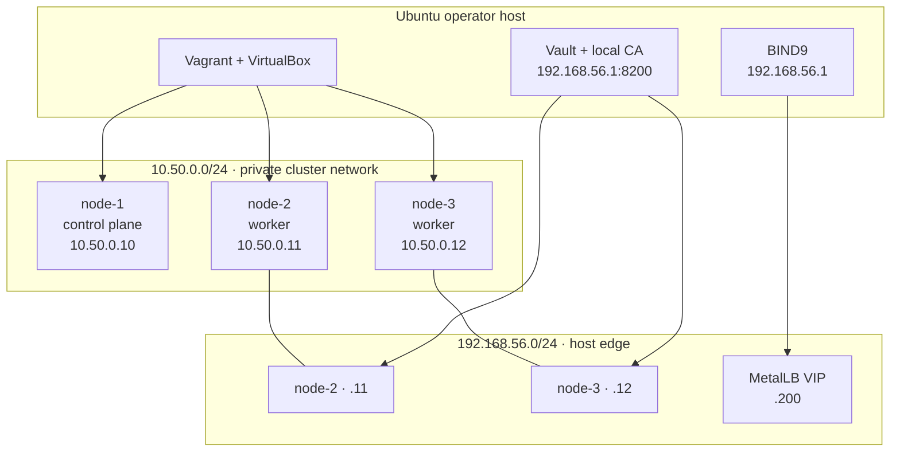
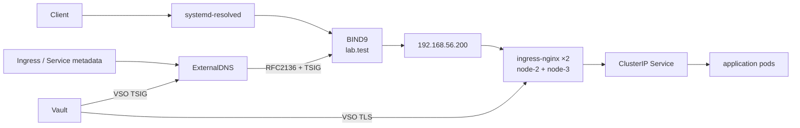
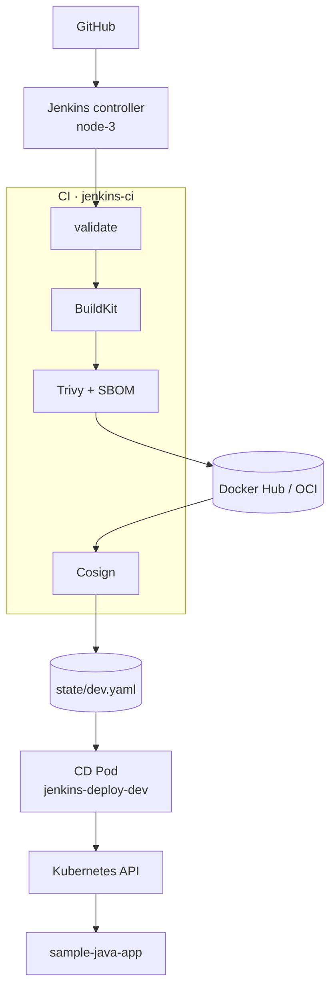
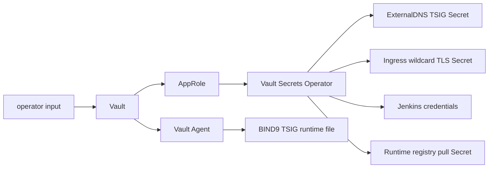
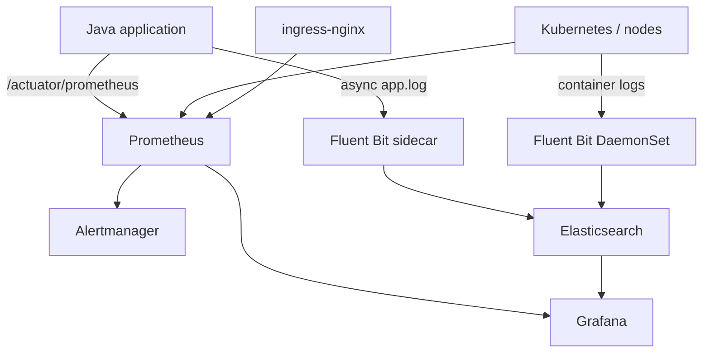

# Architecture

The platform is easier to understand as four planes: **machine**, **edge**, **delivery**, and **telemetry**.

## 1 · Machine plane



**Why two networks?** The Kubernetes control plane stays on the private VM network. Only worker nodes touch the host edge. The host can reach ingress and Vault does not require exposing control-plane ports on the edge.

| Plane | Address |
|---|---|
| VM | `10.50.0.0/24` |
| Pod | `10.60.0.0/16` |
| Service | `10.70.0.0/16` |
| host edge | `192.168.56.0/24` |
| ingress VIP | `192.168.56.200` |

Deep dive: [infra/README.md](../infra/README.md)

## 2 · Edge plane



The edge has one public entry point for the lab: ingress-nginx. MetalLB allocates the VIP explicitly; ExternalDNS writes the matching DNS records; Vault supplies the secret material.

Deep dive: [edge](../infra/edge/README.md) · [cluster edge](../platform/edge/README.md)

## 3 · Delivery plane



The invariant is simple:

```text
source ──► build once ──► scan ──► publish exact bytes ──► sign digest
                                                       │
                                                       ▼
                                               state/<env>.yaml
                                                       │
                                                       ▼
                                               deploy same digest
```

CI can dry-run Kubernetes writes but admission blocks real writes. CD receives an environment-specific ServiceAccount and no application Secret read permission.

Deep dive: [DELIVERY.md](../DELIVERY.md) · [Jenkins](../platform/jenkins/README.md)

## 4 · Secret plane



Private keys, root/unseal material, GitHub tokens, Docker Hub tokens, and runtime credentials are excluded from Git. Git stores policies and references; Vault stores the secret values.

## 5 · Telemetry plane



Prometheus is also a release-safety dependency: production canary evaluation queries ingress 5xx metrics before the stable release is updated.

Deep dive: [observability](../platform/observability/README.md)

## Source-of-truth boundaries

| Change | Source |
|---|---|
| VM shape / host networking | [`Vagrantfile`](../Vagrantfile) |
| Kubernetes version / CIDRs | [`infra/ansible/group_vars/all.yml`](../infra/ansible/group_vars/all.yml) |
| host trust / DNS / Vault | [`infra/`](../infra/README.md) |
| Kubernetes edge | [`platform/edge/`](../platform/edge/README.md) |
| Jenkins runtime + jobs | [`platform/jenkins/`](../platform/jenkins/README.md) |
| application runtime | [`app/chart/`](../app/README.md) |
| reusable service behavior | [`charts/service/`](../charts/service/README.md) |
| release identity | [`state/*.yaml`](../state/) |
| CI/CD behavior | [`delivery/`](../delivery/README.md) |
| admission | [`policies/`](../policies/README.md) |
| proofs | [`validation/`](../validation/README.md) |

## Failure boundaries

```text
bad source / lint / test / scan
  └── stops before publish

bad signature / promotion / dry-run
  └── stops before runtime change

failed Helm readiness
  └── Helm rollback-on-failure

failed Helm smoke test
  └── explicit runtime rollback

bad production canary
  └── canary removed; stable release untouched
```

The platform keeps desired state and recovery distinct: a runtime rollback protects service availability; Git is then fixed or reverted to restore the desired state.
