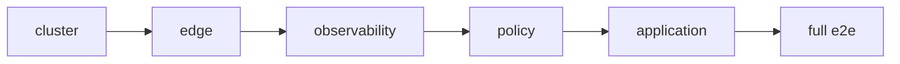

# Validation

Configuration says what should happen. These checks prove what **did** happen.



## Fast map

| Scope | Command | Proves |
|---|---|---|
| Kubernetes foundation | `make cluster-validate` | exact 3-node topology, versions, CIDRs, Calico, cross-node Pod traffic, dynamic storage |
| container | `make container-validate` | build/test, OCI labels, endpoint, probes, file log, metrics, non-root minimal runtime |
| edge smoke | `make edge-smoke` | Vault/BIND/edge workloads/DNS/HTTPS are alive |
| edge deep | `make edge-validate` | network boundaries, Vault TLS/audit/policies, signed DNS updates, ExternalDNS lifecycle, trusted ingress |
| observability | `make observability-smoke` | workloads, PVCs, alert rules, public metrics/Grafana endpoints, Elasticsearch, Fluent Bit |
| policy | `make policies-smoke` | webhook replicas/TLS/scope/fail-closed behavior and real admission decisions |
| complete platform | `make e2e-validate` | all of the above plus Jenkins and the current application release |

## What the full check expects

```text
Jenkins controller
  └── node-3 + bound persistence + trusted hostname + 0 executors

application
  ├── configured replica count Ready
  ├── multi-replica profiles spread across node-2 + node-3
  ├── immutable digest
  ├── restricted runtime
  ├── correct PDB behavior for replica count
  ├── DNS + trusted HTTPS
  └── request reaches async file log

telemetry
  ├── application Prometheus target UP
  ├── JVM metrics present
  ├── dashboards provisioned
  └── request log reaches Elasticsearch

admission
  └── missing CPU / memory requests are rejected by the real API path
```

The current `dev` profile is one application replica; the validator reads the live desired replica count instead of pretending dev has four. The base/prod profile defines the required four-replica layout. See [requirements coverage](../docs/REQUIREMENTS.md#1-four-pods-two-workers-nginx-health).

## Failure rule

A validation script should answer one question:

```text
Does the running system match the repository contract?
```

It should not mutate permanent desired state to make itself pass. Temporary validation objects are created only where the test requires them and are cleaned up afterward.
